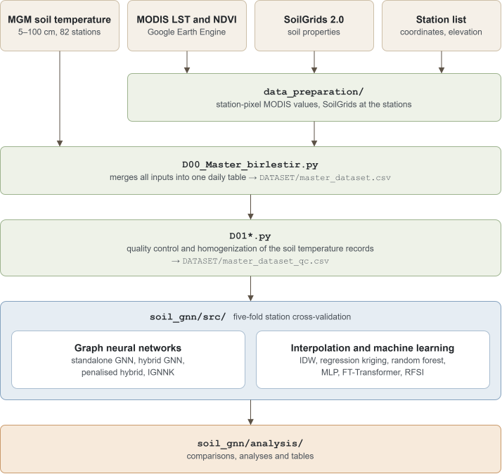

# Soil temperature at unmonitored sites: graph neural networks and spatial interpolation

Code for the paper "Graph neural networks and spatial interpolation for multi-depth soil temperature at unmonitored sites".

Daily soil temperature at 5, 10, 20, 50 and 100 cm is estimated at 82 stations of the Turkish State Meteorological Service (MGM), 2015–2025, from MODIS land surface temperature and NDVI, SoilGrids and elevation. Each station is held out once in five-fold cross-validation. Graph neural networks (a standalone GNN, a hybrid GNN that corrects elevation-detrended IDW, a penalised hybrid and IGNNK) are compared with IDW, regression kriging, random forest, MLP, FT-Transformer and RFSI.

Identifiers, comments and most file names are in Turkish.

## Structure

```
data_preparation/          Earth Engine scripts and merging of MODIS LST, NDVI and SoilGrids
D00_Master_birlestir.py    merges all inputs into DATASET/master_dataset.csv
D01*.py                    quality control and homogenization of the soil temperature records
DATASET/                   station list
soil_gnn/src/              models, folds and smoke test
soil_gnn/analysis/         analyses and table bodies of the paper
```



## Installation

```
pip install -r requirements.txt
```
Install PyTorch and PyTorch Geometric for your platform first. The results were computed with Python 3.10 and the versions in `requirements.txt`.

## Data

The soil temperature records are available from MGM on request. MODIS, SoilGrids, ETOPO 2022 and Natural Earth data are public. `DATASET/MGM_istasyonlar_final.csv` lists the 82 stations. `D00` also reads a soil moisture file that the models do not use; a file with only the header `istasyon_no,tarih,soil_moisture` is enough.

## Running

Run all commands from the repository root.

1. Inputs: the Earth Engine scripts in `data_preparation/*/scripts/`, the merge scripts in `data_preparation/`, then `python D00_Master_birlestir.py`.
2. Quality control (only data up to 2023 enter break detection):
   ```
   KIRILMA_ETIKET=_orta KIRILMA_T=25 KIRILMA_ADIM=0.5 KIRILMA_ISABET=3 KIRILMA_ORAN=0.6 QC_SON_TARIH=2023-12-31 python D01a_Kirilma_Taramasi.py
   QC_SON_TARIH=2023-12-31 QC_TEST_KIRILMA=0 python D01c_Homojen_Dongu.py
   ```
3. Models, per fold (`--kat 0` to `4`):

   | Model | Script in `soil_gnn/src/` |
   |---|---|
   | standalone and hybrid GNN | `toprak_gnn_calistir.py` (hybrid: `--idw-artik`) |
   | IDW, elevation-detrended IDW | `idw_karsilastirma_modeli.py` (`--rakim`) |
   | regression kriging | `kriging_karsilastirma_modeli.py --rakim` |
   | random forest, MLP, FT-Transformer | `rf_mlp_transformer_karsilastirma_modelleri.py` |
   | RFSI | `rfsi_karsilastirma_modeli.py` |
   | IGNNK | `ignnk_karsilastirma_modeli.py` |

   Learned models run in two stages: stage 1 (`--ic-dogrulama`) selects the number of epochs on the inner validation stations (for RFSI, the number of neighbours), stage 2 retrains with seeds 0, 1 and 2; the random forest has a single stage. The settings chosen per fold are listed in the appendix of the paper; `python <script> --help` lists the options.
4. Analyses: the scripts in `soil_gnn/analysis/` read `soil_gnn/results/` and write the analyses and table bodies of the paper.

## Tests

```
python soil_gnn/src/toprak_duman_testi.py
python soil_gnn/analysis/katli_analiz_testi.py
```

## License

MIT. A citation will be added after publication.
